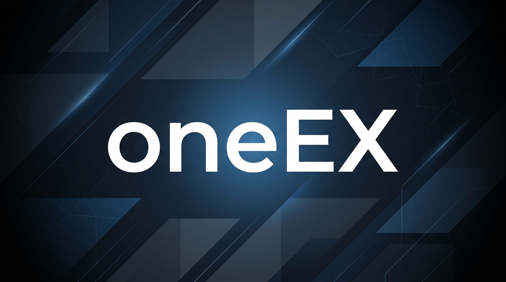

<p align="center">
  
</p>

<p align="center">
  
  
  
  
</p>

---

## Overview & Architecture

This project enables running a complete, secondary Android operating system directly alongside One UI on a rooted Samsung Galaxy device, allowing instant switching between the two environments without modifying system partitions or flashing custom ROMs. 

Unlike traditional multi-boot solutions that require repartitioning internal storage, modifying bootloaders, or rebooting into separate kernels, this architecture operates entirely at the userspace and container level:

* **Host Preservation:** One UI remains completely intact on its native partitions.
* **Containerized Guest:** The secondary operating system resides inside a dedicated directory on the device's data partition and executes directly on top of One UI's active Linux kernel.
* **Isolated Runtime:** The guest environment initializes its own isolated `zygote`, `system_server`, surfaceflinger, and framework services inside a dedicated mount and PID namespace.
* **Hardware & Vendor Passthrough:** Because the host kernel, radio interface layer (RIL), modem, and low-level vendor HAL services remain active underneath, the guest OS inherits hardware initialization without needing separate kernel builds.
* **Bidirectional Switching:** You initiate the transition from the companion manager app inside One UI and return using the **Back to One UI** trigger app inside the guest OS—or via a hardware emergency fallback by holding **Volume Up + Volume Down** for 3 seconds.

This project evolved from [OneLineage](https://github.com/WeWaffles/OneLineage) by WeWaffles, and builds its guest system images using [MysticGSI](https://github.com/MysticGSI/mysticgsi). See [Credits](#credits) for full attributions.

> [!WARNING]
> **EXPERIMENTAL SOFTWARE — HIGH RISK OF DATA LOSS.**
> Do not attempt to use this software unless you thoroughly understand Android system internals, root privilege escalation, and recovery procedures. The switching engine replaces and suspends core components of a live, running Android OS with root privileges. 
>
> **Known Historical Failure Modes:**
> * During early development cycles, a misconfigured guest container accessed One UI's `/data` mount point and corrupted/deleted host application data and personal media.
> * A guest environment previously overwrote the device's hardware-backed lock-screen credential slot (Weaver/Gatekeeper), locking One UI permanently until a full factory data reset was performed.
>
> While strict namespace guards, virtualized storage mounts, and credential isolation layers are now enforced to prevent these issues, untested device/image combinations can still fail unpredictably. **You must perform a complete external backup of all accounts, photos, and local files, and completely remove your host screen lock (PIN, pattern, password, fingerprint, and face unlock) prior to switching.** Only deploy this on a secondary or development device you can afford to wipe. Neither Samsung, Google, OPPO, vivo, Xiaomi, nor Nothing endorse or support this software.

---

## Project Status & Compatibility Matrix

* **Current Engine Version:** `0.4.93`
* **Supported Form Factors & Series:** Galaxy Z Fold, S, Z Flip, A, F, and M series devices.
* **Supported SoC Architectures:** Qualcomm Snapdragon, Samsung Exynos, and MediaTek.
* **Host Firmware Requirements:** One UI 9 (Android 17 base) for most guest images; One UI 8.0 / 8.5 (Android 16 base) specifically for OxygenOS 16 guest images.
* **Privilege Requirements:** Full root access is mandatory. Primarily developed and validated using **KernelSU**; **Magisk** and **APatch** are detected by the manager app but remain officially untested.

### Verifying Device Eligibility
Consult [docs/devices.md](docs/devices.md) for the authoritative registry of every device model accepted by the manager's internal compatibility table, along with recent tester telemetry. The manager features an adaptive SESL9 card picker, dedicated pre-boot verification checks, setup/update pipelines, and optional verbose console output during entry and exit transitions. Refer to the [UI gallery](docs/app/redesign-gallery.md) for cover and inner-display layouts, and [boot handoff notes](docs/boot-status.md) for display lifecycle management and release packaging specifications.

Feature-by-feature functionality logs across versions are tracked in [docs/compatibility.md](docs/compatibility.md).

| Guest System | Verified Devices Reaching Home Screen |
| :--- | :--- |
| **ColorOS 17** *(Find N6 build)* | Galaxy Z Fold8 Ultra, Z Fold8, Z Fold7, Z Fold6, Z Fold5 |
| **ColorOS 17** *(Find X9 Ultra IN global build)* | Galaxy S26 Ultra, S26+, S26 *(both chips each)*, S25 Ultra, S25+, S25, S25 Edge, S24 Ultra, S24 *(both chips)*, S23 Ultra, S23+, S23, Z Flip7, Z Flip6, Z Flip5, A57, A56, A55 5G, A54 5G, A36, A35 5G, A34 5G, A27, A26, A17, A17 5G, A16 4G, A16 5G, A15, A07 |
| **Pixel 11 Fold** | Galaxy Z Fold8 Ultra, Z Fold8 |
| **Pixel 11 Pro** | Galaxy S26 Ultra, S26+ *(both chips)* |
| **Pixel 9 Pro XL** | Galaxy S25 Ultra, S25, S24 Ultra, S24, S24 FE, S23 Ultra, S23+, S23, Z Flip5, A57, A56 |
| **Infinity-X 4.1** | Galaxy S26 Ultra, S25 Ultra, S25, S24 Ultra, S23 Ultra, S23, Z Fold6, Z Flip5, A57, A56, A54 5G, A36, A27, A26, A17, A17 5G, A16 4G, A16 5G, A07 |
| **HyperOS** *(Xiaomi 18 Fold)* | Galaxy Z Fold8, Z Fold7, S26 Ultra, S26, S25 Ultra, S25+, S25, S25 Edge, S24 Ultra, S23 Ultra, S23, Z Flip5, A57, A56, A36, A27, A17, A17 5G, A16 4G, A16 5G, A07 |
| **Nothing OS 5.0** | Galaxy Z Fold8 Ultra, Z Fold7, Z Fold6, S26 Ultra, S26, S25 Ultra, S25+, S25, S25 Edge, S24 Ultra |
| **OriginOS 7** | Galaxy Z Fold8 Ultra, Z Fold7, S26 Ultra, S25+, S25 |
| **OxygenOS 16** *(Android 16, for One UI 8 hosts)* | Galaxy S22 Ultra *(both chips)*, S22+, S22 *(Snapdragon)*, S23 FE, A34 5G, A24, A15, M55s, A16 5G (`SM-S166V`) |

---

## Detailed Hardware & Profile Notes

Reaching the launcher home screen does not guarantee full hardware parity. For example, on **Infinity-X 4.1**, field reports indicate that voice calls fail and SMS works intermittently; version `0.4.31` introduced an **IMS override toggle** under Advanced settings to address cellular registration on Infinity-X and HyperOS. On the **Galaxy Z Flip5**, camera HAL initialization previously failed across both host and guest environments until a fix was merged in `0.4.31`.

### Untested & Experimental Profiles
When selecting an unverified combination, the manager requires explicit acknowledgment before initiating a switch:
* **ColorOS 17 Profiles:** Untested validation flags apply to Galaxy Z Fold8 (`SM-F971`), Z Fold7 (`SM-F966`), Galaxy S26+ (`SM-S947`), S26 (`SM-S942`, `SC-51G`), S25+ (`SM-S936`), and S24 Ultra (`SM-S928`). The Find X9 Ultra IN (global) ColorOS 17 build includes full Google Play Services and Play Store integration across supported Galaxy S models.
* **Pixel Guest Images:** Pixel 11 Fold is mapped to the Z Fold8, while Pixel 11 Pro targets the Galaxy S26 Ultra, S26+, and S26 (requiring newer ARMv9 CPU instruction sets). Pixel 9 Pro XL targets the Galaxy S25 Ultra, S25, S25+, and S24 Ultra, with expanded support added in `0.4.30` for the Galaxy S23, S23+, Z Flip5, Z Flip7, A57, and (in `0.4.31`) the A56.
* **Custom & Foldable Ports:** Infinity-X 4.1 (added `0.4.27`, built from the Find X9 Ultra tree with full Google apps) and HyperOS (added `0.4.31`, ported from the Xiaomi 18 Fold) are available across listed devices. On the Z Fold8 Ultra and Z Fold8, HyperOS dynamically adapts its cover-screen UI layout; on candybar phones, it defaults to standard single-screen mode.
* **Legacy Vendor Warnings:** The Galaxy S23 (`SM-S911`), S23+ (`SM-S916`), Z Flip5 (`SM-F731`, added `0.4.29`, running on the inner display only), and S23 Ultra (`SM-S918`, added `0.4.40`) are permitted strictly for diagnostic testing. Their older vendor partitions frequently fail to initialize Android 17 guests; in those cases, the watchdog automatically reverts to One UI—please submit session logs if this occurs.

### Exynos SoC Bring-Up Status
* **Exynos 2500 & Next-Gen:** Support covers the Galaxy S26+ Exynos (`SM-S947B`, `m2s`) with both Find X9 Ultra builds and Pixel 11 Pro, as well as the Galaxy Z Flip7 (`SM-F766`, Exynos 2500) with both Find X9 Ultra builds (operating on the main screen without cover UI support yet).
* **Mid-Range Exynos:** Added in `0.4.29` for the Galaxy A57 (`SM-A576`, `a57x`) and in `0.4.31` for the Galaxy A56 (`SM-A566`, `a56x`) using the Find X9 Ultra image sets.
* **Exynos 2400:** Added in `0.4.40` for the Galaxy S24 (`SM-S921`, `e1s`) utilizing S23 image profiles, and in `0.4.83` for the Galaxy S24+ (`SM-S926B`, `e2s`), which shares the S24 Ultra's six system profiles. These two models are the first Exynos devices cleared to test **OriginOS 7**.
* **Z Flip6 Hybrid Profile:** The Galaxy Z Flip6 (`SM-F741`, Snapdragon 8 Gen 3) shares the S24 Ultra's image matrix (excluding HyperOS prior to `0.4.40`) and renders on the main screen.
* While early kernel panic and reboot loops on the S26+ and Z Flip7 have been resolved, all Exynos configurations remain marked as untested. Infinity-X is also selectable across these profiles.

### Recent Additions (`0.4.67` – `0.4.91`)
* **OxygenOS 16 (`0.4.67`+):** Backported Android 16 guest support for devices remaining on One UI 8.0 or 8.5, including the Galaxy S22 lineup, S23 FE, A/F/M series devices, and (as of `0.4.91`) the Galaxy S23, S23+, and S23 Ultra.
* **OriginOS 7 (`0.4.73`+):** vivo's Android 17 build enabled for Snapdragon Galaxy S26, S25, Z Fold8 Ultra, Z Fold8, and Z Fold7, expanding in `0.4.82` to Snapdragon S24 and S23 models.

Release notes are archived in [changelog.md](changelog.md). Known system-specific bugs are documented in `docs/pixel-guest.md` and `docs/coloros-on-fold.md`. Any unlisted hardware, SoC, or firmware version is blocked by pre-flight safety checks.

---

## Submitting Hardware Telemetry (Unlisted Devices)

If your Galaxy model is rejected by the compatibility check, run the standalone **Device Probe** utility:
1. Download the Probe APK from the same release folder as the main manager app.
2. Grant root permissions (required to inspect partition layouts, vendor props, and kernel flags—the tool is strictly read-only and modifies nothing).
3. Tap **Run tests**. The utility automatically redacts sensitive identifiers including IMEI numbers, phone numbers, and saved Wi-Fi SSIDs.
4. Tap **Send to the project team** (`0.4.29`+), or tap **Share** to export the diagnostic `.zip` archive and upload it alongside your exact model number in the **Phone reports** topic of the [community Telegram group](https://t.me/TheoneOS).

---

## Installation & Getting Started

### Phase 1: Mandatory Pre-Flight Preparation
Do not skip any of these prerequisites:

1. **Verify Hardware Support:** Confirm your exact model number appears in the compatibility matrix above or in `docs/devices.md`.
2. **Create Complete Backups:** Back up all accounts, messages, app data, and media via Samsung Cloud, Google Backup, Smart Switch, or local ADB/PC transfers.
3. **Disable Host Screen Lock:** Navigate to **Settings › Lock screen › Screen lock type** and select **None** or **Swipe**. Remove all PINs, patterns, passwords, fingerprints, and face data. If a session crashes or boot-loops while file-based encryption (FBE) keys are locked, recovery may require a factory wipe. The manager blocks switching while a lock is active.
   * *Note on Force-Switch:* Version `0.4.32` added an override under **Advanced › Risky** to bypass the lock check. Because One UI's user data is cryptographically tied to your lock credential, any slot corruption will force a reset—keep this disabled unless you accept total data loss.
   * *In-Guest Screen Locks:* Starting in `0.4.95`, supported guests (ColorOS, HyperOS, Nothing OS, OriginOS) allow setting a local PIN, pattern, or password isolated inside the container without touching One UI's secure hardware keystore. This restricts casual UI access inside the guest only and does not encrypt guest storage. See [docs/guest-screen-lock.md](docs/guest-screen-lock.md).
4. **Check Power & Thermals:** Ensure root access is active, battery charge is **above 30%**, and device skin/battery temperature is **below 42 °C**.

### Phase 2: Setup & Switching

5. **Install the Architecture-Specific Manager APK:** Starting in `0.4.25`, builds are split into three variant APKs to reduce download size by ~50%:
   * `manager-<version>-fold.apk` — Galaxy Z Fold8 Ultra, Z Fold8, Z Fold7, Z Fold6, Z Fold5
   * `manager-<version>-s26.apk` — Galaxy S26 Ultra, S26+, S26, Z Flip8
   * `manager-<version>-s25.apk` — All other supported models (S25 series, S24/S23/S22 series, Z Flip7/6/5, and A/F/M series)
   * *(If you install the wrong variant, the app will display an error specifying the exact APK required for your device.)*
6. **Download a Guest Image:** Open the manager, navigate to **Systems**, and download a compatible guest package over Wi-Fi (file sizes range from **3.3 GB to 5.9 GB**).
7. **Stage the Container:** Return to the manager, tap **I have the file**, select your downloaded archive, and tap **Set up**. Provisioning and framework patching take roughly **15 minutes**—keep the app in the foreground and connect a charger. One UI remains fully usable during staging.
8. **Boot the Guest OS:** Tap **Switch**.
   * **Returning to One UI:** Open the **Back to One UI** app inside the guest launcher (usually performs a warm userspace swap without rebooting), or press and hold **Volume Up + Volume Down** for 3 seconds.
   * **Emergency Recovery:** If the boot animation freezes, hold **Power + Volume Down** until the device hard-reboots back into One UI. *(If you use non-persistent root, re-activate your root environment after rebooting.)*

---

## Multi-System Management, Reporting & Cleanup

### Session Telemetry & Bug Reporting
* **In-Guest Checklists (`0.4.30`+):** While running a guest OS, open the companion app and tap **How's it going?** to check off working hardware components in real time.
* **Post-Session Submission (`0.4.29`+):** Back in One UI, open **Last session** and tap **Send to the team**. By default, only trimmed boot/exit logs are uploaded (full logs are attached automatically if you flag a hardware failure). Logs are scrubbed of personal identifiers and retained for 30 days. Aggregated pass/fail counters are published publicly in [docs/compatibility.md](docs/compatibility.md).

### Managing Multiple Guest OS Installations
From version `0.4.30` onward, setting up a second guest OS preserves your existing guest container (including all installed apps and account logins) as a dormant snapshot.
* Saved containers appear on the home screen as **Switch to `<system>`**.
* Tapping a saved container snapshots your current guest, updates runtime bridge binaries if needed (~2 minutes), and boots the target environment.
* Unused containers can be deleted directly from the home card or via **Advanced › Free up space**.

### Complete Uninstallation
1. Open **Advanced › Remove container data** inside the manager app.
2. The uninstaller verifies that no guest mount points or daemons remain attached to One UI, then wipes all active containers, dormant snapshots, and session logs while leaving host One UI data and downloaded raw `.img`/`.zip` archives untouched.
3. Uninstall the manager APK normally.
4. **CLI Fallback:** If you already uninstalled the app, execute `sh remove-oneos-data.sh` (located in `scripts/`) from a root shell such as Termux. Pass `--dry-run` first to preview target paths before deletion.

---

## Technical Under-the-Hood Flow

1. **Image Conversion & Patching:** On a Linux build host, stock OEM firmware is converted into a generic system image via MysticGSI, and `scripts/make-overlays.sh` applies bytecode/resource patches (`switcher/patches/`) to adapt the framework for container execution.
2. **Verification & Staging:** The manager verifies the archive's byte size and SHA-256 checksum against an embedded allowlist (`Images.kt`), then extracts and stages the filesystem inside `/data/local/tmp/oneos` as root.
3. **Namespace & Process Handoff:** `switcher/assets/oneos_switch.sh` cleanly halts One UI's `zygote` and `system_server` processes while keeping the kernel, vendor daemons, and cellular radio alive. `guest_prepare.sh` and `guest_start.sh` then spin up a new mount namespace mapping `/system` to the guest image and `/data` to the isolated stage directory.
4. **Isolation Guards:** Custom `vold`, storage, and `installd` hooks block access to host partitions, prevent `weaver` or `gatekeeper` keystore writes, block secondary Android user creation, and isolate app UID ranges (`docs/app/patch-catalog.md`).
5. **Teardown & Return:** `return_to_oneui.sh` terminates the guest namespace and restores One UI's framework processes in place whenever possible, falling back to a clean reboot if kernel state requires it (`docs/inplace-return.md`).

---

## Guest Root & Module Management

Both the pre-boot configuration screen and the in-guest companion app support managing guest-level root grants, Magisk/KernelSU-style modules, and Zygisk injection frameworks independently of the host. Refer to [setup and build instructions](docs/guest-runtime.md) and [root-provider compatibility limits](docs/guest-root-provider-compatibility.md) for details.

---

## Repository Structure

| Directory | Description |
| :--- | :--- |
| `app-android/` | Main manager application, Device Probe diagnostic utility (Kotlin with SESL One UI styling), in-guest return app, and unit test suites |
| `switcher/assets/` | Runtime shell orchestration scripts (`switch`, `prepare`, `start`, `return`, and IPC bridges) |
| `switcher/patches/` | Python and smali framework patchers invoked by `make-overlays.sh`, plus Samsung `installd` interface definitions |
| `switcher/overlays/` | Runtime resource overlays (RROs) for display cutouts, DPI scaling, and hardware quirks |
| `switcher/native/` | C/C++ native source for the guest zygote launcher (`zygote_exec`) and namespace utilities |
| `scripts/` | Host-side build automation, overlay generators, ADB deployment helpers, and log scrapers |
| `docs/` | Architecture deep-dives, patch catalogs, hardware bring-up notes, and compatibility tables |

---

## Building from Source

```sh
git clone [https://github.com/fahadalijaved/OneOS.git](https://github.com/fahadalijaved/OneOS.git)
cd OneOS/app-android
./gradlew assembleProbeDebug     # Builds the standalone Device Probe APK (no external assets needed)
./gradlew test                   # Executes unit tests (requires dash or busybox for shell script tests)
